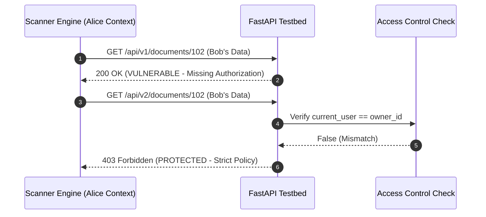

# 🛡️ API IDOR Sentinel (Object-Level Access Control Engine)

An automated security verification tool designed to audit Broken Object Level Authorization (BOLA / IDOR) in REST APIs (OWASP API Security Top 10).

## 🚀 Key Highlights
- **Multi-Tenant Authorization Testing:** Simulates cross-tenant resource queries to evaluate access boundaries.

- **Automated Policy Enforcement:** Verifies that APIs return strict `403 Forbidden` responses on unauthorized object references.

- **Structured Dual Reporting:** Generates developer-ready markdown reports (`SECURITY_AUDIT_REPORT.md`) and machine-readable logs (`audit_results.json`).

## 🛠️ Tech Stack
- Python 3.10+
- FastAPI & Uvicorn (Reference Testbed API)
- HTTPX (API Verification Client)
- Pydantic

## 📊 Architecture & Verification Flow



## 🖥️ Live Audit Output

======================================================================
          API OBJECT-LEVEL AUTHORIZATION AUDIT REPORT         
======================================================================

Target: /api/v1/documents/{id}
Result: [ FAIL / VULNERABLE ] (HTTP 200)
Severity: HIGH
Audit Note: BROKEN ACCESS: Resource returned without tenant ownership verification.
----------------------------------------------------------------------

Target: /api/v2/documents/{id}
Result: [ PASS / PROTECTED ] (HTTP 403)
Severity: NONE
Audit Note: SECURE: Strict 403 Forbidden enforced on cross-tenant access.
----------------------------------------------------------------------

## ⚙️ How to Run

1. Install dependencies:
   ```
   pip install -r requirements.txt
   ```
2. Start the API testbed:
   ```
   uvicorn mock_api:app --port 8000 --reload
   ```
3. Run the automated audit engine:
   ```
   python main.py
   ```
   